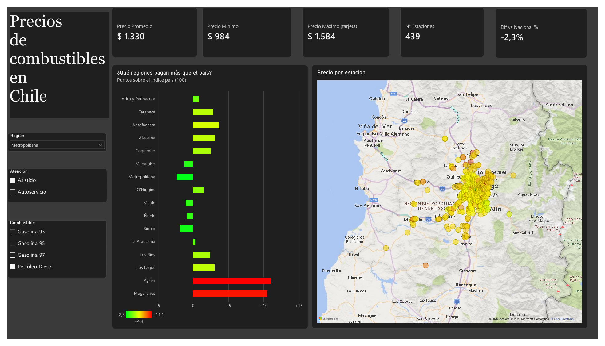
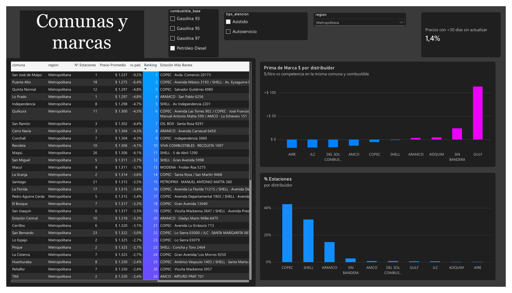
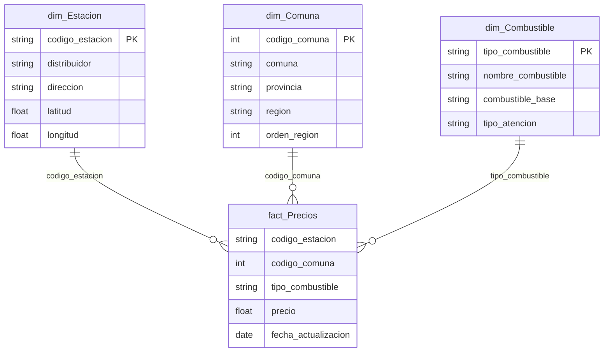

# Precios de combustibles en Chile — Dashboard en Power BI

Dashboard de precios de bencina y diésel en **1.753 estaciones de servicio** de Chile, construido en Power BI sobre datos de la **Comisión Nacional de Energía (CNE)**. Compara precios entre regiones, comunas y marcas, y ajusta las comparaciones para que no las distorsione la mezcla de combustibles ni la ubicación de cada estación.



*Capturas con filtro: Petróleo diésel, atención asistida, Región Metropolitana.*

📄 [Ver el reporte en PDF](cne_combustibles.pdf)

## Preguntas que responde

- ¿Qué regiones pagan más o menos que el promedio del país?
- ¿Cuáles son las comunas más baratas para cargar, y en qué estación?
- ¿Las marcas grandes cobran más que la competencia **en la misma comuna**?

## Hallazgos principales

*Datos al 18-06-2026.*

| | |
|---|---|
| Precio promedio Gasolina 93 | **$1.521 / litro** (diésel: $1.362) |
| Región más barata vs. el país (Gasolina 93) | **Metropolitana**, 2,6 puntos bajo el promedio |
| Regiones más caras (Gasolina 93) | **Aysén** (+7,1 pts) y **Antofagasta** (+5,9 pts) |
| Participación por número de estaciones | COPEC 40,3% · Shell 25,9% · Aramco 17,2% |
| Prima de marca en la misma comuna | COPEC −$2 · Shell −$2 · Aramco +$2 · Sin bandera +$11 |
| Ahorro del autoservicio | **~$12 por litro**, comparando dentro de la misma estación |
| Calidad de datos | 5,1% de los precios llevaba más de 30 días sin actualizarse |

Un detalle que vale la pena: en promedio simple COPEC aparece más cara que el resto, pero comparada contra la competencia **en la misma comuna y el mismo combustible** su prima es prácticamente nula. La diferencia se explica por dónde están sus estaciones, no por su precio.

## Modelo de datos

Modelo estrella con una tabla de hechos y tres dimensiones:



| Tabla | Filas | Contenido |
|---|---|---|
| `fact_Precios` | 7.436 | Un precio por estación y tipo de combustible |
| `dim_Estacion` | 1.753 | Distribuidor, dirección y coordenadas |
| `dim_Comuna` | 346 | División territorial oficial, con las regiones ordenadas de norte a sur |
| `dim_Combustible` | 8 | 93 / 95 / 97 / diésel, asistido o autoservicio |

**Power Query:** un parámetro `RutaDatos` y una consulta de staging que fija los tipos con cultura `en-US`, de la que salen el hecho y las dimensiones. El código está en [`modelo/power_query.m`](modelo/power_query.m).

## Medidas DAX destacadas

Las 25 medidas están en [`modelo/medidas.tmdl`](modelo/medidas.tmdl). Tres de las más relevantes:

**Índice de precio (país = 100):** compara cada combustible contra su propio promedio nacional antes de promediar. Así, una comuna con muchas estaciones de diésel no aparece "barata" solo porque el diésel cuesta menos.

```dax
Índice de Precio (País = 100) =
AVERAGEX (
    VALUES ( dim_Combustible[tipo_combustible] ),
    DIVIDE ( [Precio Promedio], [Precio Promedio Nacional] )
) * 100
```

**Prima de marca:** diferencia de precio de cada distribuidor frente a la competencia en la misma comuna y combustible, para controlar por ubicación.

```dax
Prima de Marca $ =
AVERAGEX (
    FILTER (
        SUMMARIZE ( fact_Precios, dim_Comuna[codigo_comuna], dim_Combustible[tipo_combustible] ),
        NOT ISBLANK ( [Precio Promedio] )
    ),
    [Precio Promedio] - CALCULATE ( [Precio Promedio], REMOVEFILTERS ( dim_Estacion ) )
)
```

**Ahorro del autoservicio:** compara asistido y autoservicio solo dentro de las estaciones que ofrecen ambos, para no mezclar estaciones distintas.

```dax
Ahorro Autoservicio $ =
VAR Pares =
    FILTER (
        SUMMARIZE ( fact_Precios, fact_Precios[codigo_estacion], dim_Combustible[combustible_base] ),
        NOT ISBLANK ( [Precio Asistido] ) && NOT ISBLANK ( [Precio Autoservicio] )
    )
RETURN
    AVERAGEX ( Pares, [Precio Asistido] - [Precio Autoservicio] )
```

Todas las medidas se validaron contra los mismos cálculos hechos en Python (pandas).

## Cómo abrirlo

1. Descarga el repositorio y abre `cne_combustibles.pbix` en Power BI Desktop.
2. En **Transformar datos → Editar parámetros**, cambia `RutaDatos` a la ruta de la carpeta `datos/` en tu computador (terminando en `\`).
3. Pulsa **Actualizar**.

El tema visual está en `tema_cne.json` (Vista → Temas → Buscar temas).

## Datos y limitaciones

- **Fuente:** API pública de la CNE (estaciones de servicio y precios vehiculares) y la codificación territorial oficial.
- Es una **foto al 18-06-2026**, no una serie de tiempo; por eso el modelo no incluye tabla calendario.
- Incluye gasolinas 93, 95 y 97 y diésel, en atención asistida y autoservicio. No incluye kerosene, GLP ni GNC.
- Algunas comunas tienen una o dos estaciones; su ranking debe leerse junto al número de estaciones.

## Origen

Este proyecto nace del proyecto final del curso **Código y Programación de Samsung Innovation Campus** (2026). Ahí lideré un equipo de cinco personas y estuve a cargo de la integración con la API de la CNE y de un dashboard en Streamlit. Esta versión rehace el análisis en Power BI, con un modelo de datos formal y medidas DAX.

---

**Pablo Rojas Silva** · [LinkedIn](https://www.linkedin.com/in/pablo-rojas-silva-b25545193/) · [GitHub](https://github.com/hungerforcoffe)
